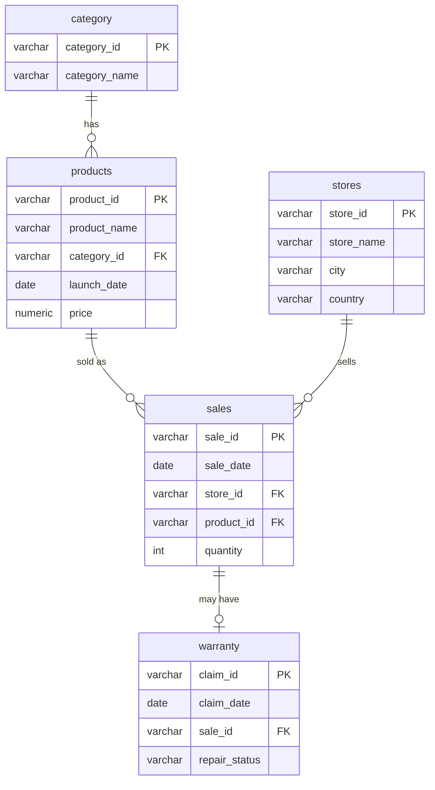

# 🍎 Apple Sales Analysis — SQL Project (PostgreSQL)


A SQL project built on a **1M+ row Apple retail dataset** (stores, categories, products, sales and warranty claims). It answers **15 business questions** — from simple aggregations to window functions, CTEs and multi-table joins — covering store performance, product trends and warranty behaviour.

---

## 📑 Table of Contents

- [Project Overview](#-project-overview)
- [Dataset](#-dataset)
- [Database Schema](#-database-schema)
- [Repository Structure](#-repository-structure)
- [Setup](#-setup)
- [Business Questions & Solutions](#-business-questions--solutions)
  - [Easy to Medium (Q1–Q10)](#easy-to-medium-q1q10)
  - [Medium to Hard (Q11–Q15)](#medium-to-hard-q11q15)
- [SQL Concepts Used](#-sql-concepts-used)
- [Author](#-author)

---

## 🎯 Project Overview

| | |
|---|---|
| **Goal** | Analyse sales and warranty data of Apple retail stores worldwide |
| **Database** | PostgreSQL |
| **Period covered** | 01 Jan 2021 – 24 Oct 2026 |
| **Size** | 73 stores · 10 categories · 115 products · ~1.04M sales · ~29K warranty claims |

> **Note:** The dataset is **synthetic**. It is modelled on Apple's real product line-up and store names, but it is not real Apple sales data.

---

## 📦 Dataset

Five CSV files, one per table:

| File | Rows | Description |
|---|---:|---|
| `stores.csv` | 73 | Apple store locations (store, city, country) |
| `category.csv` | 10 | Product categories (Laptop, Smartphone, Audio, …) |
| `products.csv` | 115 | Products with category, launch date and price (USD) |
| `sales.csv` | 1,039,639 | One row per sale: date, store, product, quantity |
| `warranty.csv` | 29,219 | Warranty claims linked to a sale, with repair status |

> `sales.csv` is distributed as `sales.csv.zip` because of its size — unzip it before loading.

**Data quality rules built into the data**

- No product is sold before its launch date.
- Every `store_id`, `product_id`, `category_id` and `sale_id` references an existing row — no orphan records, no NULLs.
- Every warranty claim is filed **after** its sale, mostly within the first year, and subscriptions never have claims.
- Stores only record sales after they open (e.g. the India stores from April 2023).
- `In Progress` claims exist only for recent claims.

---

## 🗂 Database Schema



`repair_status` values: `Repaired`, `Free Replaced`, `Paid Repaired`, `Rejected`, `Warranty Void`, `In Progress`.

---

## 📁 Repository Structure

```
apple-sales-sql-project/
├── data/
│   ├── stores.csv
│   ├── category.csv
│   ├── products.csv
│   ├── sales.csv.zip
│   └── warranty.csv
├── schema.sql
├── apple_data_analysis.sql
└── README.md
```

---

## ⚙️ Setup

**1. Create the database and tables** (`schema.sql`)

```sql
CREATE DATABASE apple_db;

CREATE TABLE category (
    category_id   VARCHAR(10) PRIMARY KEY,
    category_name VARCHAR(20) NOT NULL
);

CREATE TABLE stores (
    store_id   VARCHAR(5)  PRIMARY KEY,
    store_name VARCHAR(30) NOT NULL,
    city       VARCHAR(25) NOT NULL,
    country    VARCHAR(25) NOT NULL
);

CREATE TABLE products (
    product_id   VARCHAR(10) PRIMARY KEY,
    product_name VARCHAR(35) NOT NULL,
    category_id  VARCHAR(10) NOT NULL REFERENCES category(category_id),
    launch_date  DATE        NOT NULL,
    price        NUMERIC(10,2) NOT NULL
);

CREATE TABLE sales (
    sale_id    VARCHAR(15) PRIMARY KEY,
    sale_date  DATE        NOT NULL,
    store_id   VARCHAR(5)  NOT NULL REFERENCES stores(store_id),
    product_id VARCHAR(10) NOT NULL REFERENCES products(product_id),
    quantity   INT         NOT NULL CHECK (quantity > 0)
);

CREATE TABLE warranty (
    claim_id      VARCHAR(10) PRIMARY KEY,
    claim_date    DATE        NOT NULL,
    sale_id       VARCHAR(15) NOT NULL REFERENCES sales(sale_id),
    repair_status VARCHAR(15) NOT NULL
);
```

**2. Load the CSV files** — in this order, so the foreign keys are satisfied:

```sql
\copy category FROM 'data/category.csv' CSV HEADER
\copy stores   FROM 'data/stores.csv'   CSV HEADER
\copy products FROM 'data/products.csv' CSV HEADER
\copy sales    FROM 'data/sales.csv'    CSV HEADER   -- unzip sales.csv.zip first
\copy warranty FROM 'data/warranty.csv' CSV HEADER
```

(In pgAdmin you can use *Import/Export Data* on each table instead.)

**3. Run the analysis** — open `apple_data_analysis.sql` and run the queries below.

---

## 🧠 Business Questions & Solutions

> Questions that use `CURRENT_DATE` (Q6, Q7, Q13–Q15) return different results depending on the day you run them.

### Easy to Medium (Q1–Q10)

#### 1. Find the number of stores in each country.

```sql
SELECT country, COUNT(*) AS total_stores
FROM stores
GROUP BY country
ORDER BY total_stores DESC, country;
```

#### 2. Calculate the total number of units sold by each store.

```sql
SELECT st.store_id, st.store_name, SUM(s.quantity) AS total_units
FROM sales AS s
JOIN stores AS st ON st.store_id = s.store_id
GROUP BY st.store_id, st.store_name
ORDER BY total_units DESC;
```

#### 3. Identify how many sales occurred in December 2023.

```sql
SELECT COUNT(*) AS total_sales, SUM(quantity) AS total_units
FROM sales
WHERE sale_date >= DATE '2023-12-01'
  AND sale_date <  DATE '2024-01-01';
```

**Result:** 23,299 sales (26,137 units).

#### 4. Determine how many stores have never had a warranty claim filed.

```sql
SELECT COUNT(*) AS stores_without_claims
FROM stores AS st
WHERE NOT EXISTS (
    SELECT 1
    FROM sales AS s
    JOIN warranty AS w ON w.sale_id = s.sale_id
    WHERE s.store_id = st.store_id
);
```

**Result:** 0 — every store has had at least one claim.

#### 5. Calculate the percentage of warranty claims marked as "Warranty Void".

```sql
SELECT ROUND(
         100.0 * COUNT(*) FILTER (WHERE repair_status = 'Warranty Void') / COUNT(*),
         2
       ) AS warranty_void_pct
FROM warranty;
```

**Result:** 6.87 %

#### 6. Identify which store had the highest total units sold in the last year.

```sql
SELECT st.store_id, st.store_name, SUM(s.quantity) AS total_units
FROM sales AS s
JOIN stores AS st ON st.store_id = s.store_id
WHERE s.sale_date >= CURRENT_DATE - INTERVAL '1 year'
GROUP BY st.store_id, st.store_name
ORDER BY total_units DESC
LIMIT 1;
```

**Result (as of 24 Oct 2026):** Apple Sanlitun — 9,470 units.

#### 7. Count the number of unique products sold in the last year.

```sql
SELECT COUNT(DISTINCT product_id) AS unique_products_sold
FROM sales
WHERE sale_date >= CURRENT_DATE - INTERVAL '1 year';
```

**Result (as of 24 Oct 2026):** 115 products.

#### 8. Find the average price of products in each category.

```sql
SELECT c.category_name, ROUND(AVG(p.price), 2) AS avg_price
FROM products AS p
JOIN category AS c ON c.category_id = p.category_id
GROUP BY c.category_name
ORDER BY avg_price DESC;
```

#### 9. How many warranty claims were filed in 2024?

```sql
SELECT COUNT(*) AS claims_2024
FROM warranty
WHERE EXTRACT(YEAR FROM claim_date) = 2024;
```

**Result:** 5,591 claims.

#### 10. For each store, identify the best-selling day of the week based on highest quantity sold.

```sql
SELECT store_id, best_day, total_units
FROM (
    SELECT store_id,
           TRIM(TO_CHAR(sale_date, 'Day')) AS best_day,
           SUM(quantity)                   AS total_units,
           RANK() OVER (PARTITION BY store_id ORDER BY SUM(quantity) DESC) AS rnk
    FROM sales
    GROUP BY store_id, TRIM(TO_CHAR(sale_date, 'Day'))
) AS t
WHERE rnk = 1
ORDER BY store_id;
```

---

### Medium to Hard (Q11–Q15)

#### 11. Identify the least selling product in each country for each year based on total units sold.

```sql
WITH yearly_units AS (
    SELECT st.country,
           EXTRACT(YEAR FROM s.sale_date)::INT AS sale_year,
           p.product_name,
           SUM(s.quantity) AS total_units
    FROM sales AS s
    JOIN products AS p  ON p.product_id = s.product_id
    JOIN stores   AS st ON st.store_id  = s.store_id
    GROUP BY st.country, EXTRACT(YEAR FROM s.sale_date), p.product_name
),
ranked AS (
    SELECT *,
           RANK() OVER (PARTITION BY country, sale_year ORDER BY total_units) AS rnk
    FROM yearly_units
)
SELECT country, sale_year, product_name, total_units
FROM ranked
WHERE rnk = 1
ORDER BY country, sale_year;
```

#### 12. Calculate how many warranty claims were filed within 180 days of a product sale.

```sql
SELECT COUNT(*) AS claims_within_180_days
FROM warranty AS w
JOIN sales AS s ON s.sale_id = w.sale_id
WHERE w.claim_date - s.sale_date <= 180;
```

**Result:** 20,593 claims.

#### 13. Determine how many warranty claims were filed for products launched in the last two years.

```sql
-- Total
SELECT COUNT(*) AS total_claims
FROM warranty AS w
JOIN sales    AS s ON s.sale_id    = w.sale_id
JOIN products AS p ON p.product_id = s.product_id
WHERE p.launch_date >= CURRENT_DATE - INTERVAL '2 years';

-- Breakdown by product
SELECT p.product_name, COUNT(w.claim_id) AS total_claims
FROM warranty AS w
JOIN sales    AS s ON s.sale_id    = w.sale_id
JOIN products AS p ON p.product_id = s.product_id
WHERE p.launch_date >= CURRENT_DATE - INTERVAL '2 years'
GROUP BY p.product_name
ORDER BY total_claims DESC;
```

#### 14. List the months in the last three years where sales exceeded 3,500 units in the USA.

```sql
SELECT TO_CHAR(DATE_TRUNC('month', s.sale_date), 'YYYY-MM') AS sales_month,
       SUM(s.quantity) AS total_units
FROM sales AS s
JOIN stores AS st ON st.store_id = s.store_id
WHERE st.country = 'USA'
  AND s.sale_date >= CURRENT_DATE - INTERVAL '3 years'
GROUP BY DATE_TRUNC('month', s.sale_date)
HAVING SUM(s.quantity) > 3500
ORDER BY DATE_TRUNC('month', s.sale_date);
```

> The threshold is 3,500 units because USA monthly sales in this dataset average roughly 3,000 units. Change it in the `HAVING` clause to suit your analysis.

#### 15. Identify the product category with the most warranty claims filed in the last two years.

```sql
SELECT c.category_name, COUNT(w.claim_id) AS total_claims
FROM warranty AS w
JOIN sales    AS s ON s.sale_id     = w.sale_id
JOIN products AS p ON p.product_id  = s.product_id
JOIN category AS c ON c.category_id = p.category_id
WHERE w.claim_date >= CURRENT_DATE - INTERVAL '2 years'
GROUP BY c.category_name
ORDER BY total_claims DESC;
```

**Result (as of 24 Oct 2026):** Smartphone leads with 4,823 claims, followed by Audio (2,103) and Wearable (1,262).

---

## 🛠 SQL Concepts Used

- `GROUP BY`, `HAVING`, `ORDER BY`, `LIMIT`
- Multi-table `JOIN`s (4 tables)
- Subqueries and `NOT EXISTS`
- CTEs (`WITH`)
- Window functions — `RANK() OVER (PARTITION BY …)`
- Conditional aggregation — `COUNT(*) FILTER (WHERE …)`
- Date functions — `EXTRACT`, `DATE_TRUNC`, `TO_CHAR`, `INTERVAL`, date arithmetic

---

## 👤 Author

**Muhammad Numan Ahmed**

- GitHub: [@numanahmed0](https://github.com/numanahmed0)
- LinkedIn: [Numan Ahmed](https://www.linkedin.com/in/numan-ahmed-309819283)

⭐ If you found this project useful, consider giving it a star!
